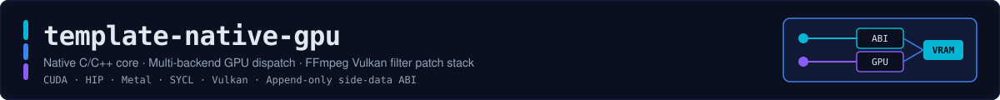
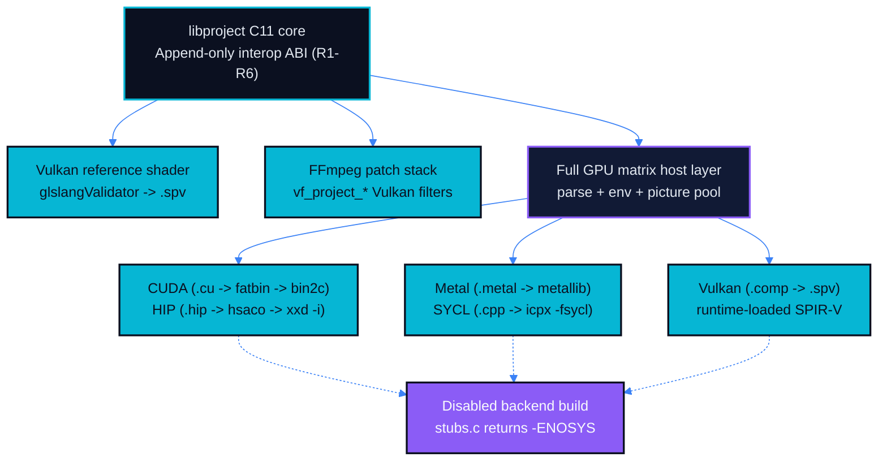

<!-- markdownlint-disable MD013 MD033 MD041 -->
<div align="center">



<!-- 1 Release -->
[](https://github.com/golusoris/template-native-gpu/releases) <!-- x-release-please-version -->
<!-- 2 CI/build: status badges join with the fleet badges renderer -->
<!-- 3 Security/scorecard -->
[](https://www.bestpractices.dev/projects/16159)
[](https://scorecard.dev/viewer/?uri=github.com/golusoris/template-native-gpu)
[](https://coderabbit.ai)
<!-- 4 Standards -->
[](AGENTS.md)
[](docs/principles.md)
[](docs/principles.md)
[](https://www.conventionalcommits.org/)
<!-- 5 Licence -->
[](LICENSE)
<!-- 6 Support: placeholder in .github/FUNDING.yml -->

**Reusable project template and boilerplate for native (C/C++), multi-backend GPU compute, and FFmpeg-filter projects.**

*Minimal C11 + Vulkan seed at the repository root, plus a five-backend CUDA / HIP / Metal / SYCL / Vulkan dispatch matrix.*

</div>

`template-native-gpu` ships a complete cross-cutting engineering layer (Meson
build, CI, supply-chain provenance, security scanning, documentation, deployment
manifests, and agent harness) together with two ready-to-adapt code layouts.
Read the [documentation site](https://golusoris.github.io/template-native-gpu/)
for the architecture overview, interop ABI reference, and ADR index.

## Why this project

Starting a native C/C++ + GPU + FFmpeg-filter repository from scratch means
assembling device-toolchain build rules, forward-compatible frame metadata
framing, non-GPU CI fallback stubs, and supply-chain gates before writing the
first real kernel. This template provides that cross-cutting layer plus two
variants of the code:

- **Minimal seed** (the repo root) — one C library (`libproject`) with an
  append-only side-data interop ABI + a hello stub, a single Vulkan reference
  shader, and an FFmpeg patch stack. This is what `meson setup build` builds.
- **Full GPU matrix** (`examples/full-gpu-matrix/`) — CUDA / HIP / Metal / SYCL /
  Vulkan compute-dispatch scaffolding behind one host layer, showing each
  backend's device-code pipeline and the load-bearing `-fsycl` / `-ENOSYS`
  patterns.

> This is a TEMPLATE. Everything compiles conceptually but the compute is
> deliberately trivial (a "scale" kernel, a "mean" function). Replace the stubs
> with your real algorithm; keep the structure, build wiring, and patterns.

### Name

- **Meaning**: a project template for native (C/C++) and GPU compute
  repositories with FFmpeg filter integration.
- **Origin**: packages the shared cross-cutting engineering layer and the
  `vmafx`-shaped multi-backend dispatch pattern ([examples/full-gpu-matrix/README.md](examples/full-gpu-matrix/README.md),
  [ADR-0001](docs/adr/0001-project-genesis.md)–[ADR-0005](docs/adr/0005-eupl-licence.md))
  into a standalone starter repository.
- **Pronunciation**: *"template native G-P-U"* (`/ˈtɛm.plɪt ˈneɪ.tɪv ˌdʒiː.piːˈjuː/`).

## Get started

```bash
meson setup build && meson compile -C build && meson test -C build   # minimal seed
meson setup build-gpu examples/full-gpu-matrix/core && meson test -C build-gpu  # matrix example
pre-commit install                                                   # the local gate
```

See [docs/development/build.md](docs/development/build.md) for the full matrix.

### Placeholder scheme

Rename these consistently when you instantiate the template (a single
case-preserving sweep does it). The scheme:

| Placeholder | Meaning | Example real value |
| --- | --- | --- |
| `project` | library + product name, lowercase (dirs, soname, pkg-config) | `pelorus` |
| `PROJECT` | the same name in prose / display form | `Pelorus` |
| `libproject` | the shared core library dir + `lib<name>.so` | `libpelorus` |
| `proj_` | C **function** + type prefix (`proj_blob_pack`, `ProjSideData`) | `pel_` / `Pelorus…` |
| `PROJ_` | C **macro** prefix (`PROJ_OK`, `PROJ_ABI_MINOR`) | `PEL_` / `PELORUS_` |
| `myproject` | the org/repo/binary name in docs, CI, deploy | `vmafx` |
| `your-org` | the GitHub org / owner | `golusoris` |

A mechanical rename (mind the case forms — `project`/`PROJECT`/`Proj`/`PROJ`):

```bash
# review first; this touches file contents AND paths.
grep -rl 'project\|PROJECT\|libproject\|proj_\|PROJ_' . --exclude-dir=.git
# then sed the contents and `git mv` the libproject/ dir + headers.
```

Also regenerate the side-data UUID (`uuidgen`) in `libproject/src/interop.c` +
`interop.h`, and update `your-org` / `myproject` / funding / email placeholders
in `.github/`, `SECURITY.md`, `mkdocs.yml`, `deploy/helm/`.

## Architecture at a glance



### The two load-bearing patterns

1. **Append-only interop ABI** — `libproject/include/project/interop.h` (rules
   R1–R6). New fields append; bump `PROJ_ABI_MINOR`; the `_Static_assert` locks +
   `interop_test.c` are the backstop. See
   [ADR-0002](docs/adr/0002-interop-sidedata-abi.md) and
   [docs/api/interop-abi.md](docs/api/interop-abi.md).
2. **GPU dispatch + `-ENOSYS` stubs + `-fsycl` propagation** — every backend
   builds on a stock runner (no GPU SDK) via a stub TU; SYCL's `-fsycl` link arg
   is propagated once through `declare_dependency(link_args)`. See
   [ADR-0004](docs/adr/0004-gpu-backend-dispatch.md) and
   [examples/full-gpu-matrix/README.md](examples/full-gpu-matrix/README.md).

## Guides and reference

- [Documentation site](https://golusoris.github.io/template-native-gpu/) (`docs/index.md`)
- [Engineering principles](docs/principles.md) — Power of 10, SEI CERT C/C++, C4 + ADRs, SLSA Build L2
- [Architecture overview](docs/architecture/overview.md) — containers, interop spine, and GPU dispatch
- [Interop ABI reference](docs/api/interop-abi.md) — wire layout and evolution rules R1–R6
- [Build & test guide](docs/development/build.md) — minimal seed, full GPU matrix, FFmpeg patch stack, sanitizers
- [Full GPU-matrix example](examples/full-gpu-matrix/README.md) and [FFmpeg patch stack](ffmpeg-patches/README.md)
- [ADR workflow](docs/development/adr-workflow.md) and [ADR index](docs/adr/README.md)

### What you get (the cross-cutting layer)

- **Build**: meson + ninja, warning-clean baseline, pkg-config export.
- **CI** (`.github/workflows/`): `ci` (build+test matrix, format/lint),
  `security-scans` (CodeQL, semgrep, trivy, gitleaks, cargo-deny),
  `sanitizers` (ASan/UBSan/TSan + fuzz smoke), `supply-chain` (build
  provenance + cosign keyless + SBOM), `scorecard`, `docker-publish`
  (multi-arch + provenance), `release-please`, `required-aggregator` (the
  single required check).
- **Quality config**: `.clang-format`, `.clang-tidy`, `.semgrep.yml`,
  `.gitleaks.toml`, `.cppcheck-suppressions.txt`, `.codespellrc`,
  `.markdownlint.json`, `.editorconfig`, `.iwyu.imp`, `.pre-commit-config.yaml`,
  `renovate.json`, `deny.toml`, `release-please-config.json`.
- **Docs**: ADR template + workflow + 4 seed ADRs, `principles.md`,
  architecture overview, the interop-ABI reference, `mkdocs.yml`.
- **Changelog**: `changelog.d/` fragments + a renderer
  (`scripts/release/concat-changelog-fragments.sh`); ADR allocator
  (`scripts/adr/next-free.sh`).
- **Community health**: `SECURITY.md`, `GOVERNANCE.md`, `MAINTAINERS.md`,
  `CONTRIBUTING.md`, `CODE_OF_CONDUCT.md`, `SUPPORT.md`, `.github/`
  (CODEOWNERS, FUNDING, issue + PR templates).
- **License**: EUPL-1.2 (code) + CC-BY-SA-4.0 (docs) + LGPL-2.1-or-later
  (FFmpeg patches), mapped by `REUSE.toml`; texts in `LICENSES/`, plus `NOTICE`.
- **Deploy**: app-agnostic Helm chart (Deployment | Job | StatefulSet, GPU node
  affinity, ServiceMonitor, hardened pod security, `values.schema.json`),
  devcontainer, dev Dockerfiles (host / CUDA / SYCL).
- **AI agents** (`.claude/`): per-backend reviewer agents, hooks
  (block-unsafe-bash, auto-format, docs-drift), skills (`add-gpu-backend`,
  `new-adr`, `render-changelog`, `cut-release`), and a least-privilege
  `settings.json` allowlist.

## Contribute

Contributions follow [CONTRIBUTING.md](CONTRIBUTING.md) and the
[Code of Conduct](CODE_OF_CONDUCT.md). Before pushing, run the local gate
(`pre-commit run --all-files` and `meson test -C build`), use Conventional
Commits, and add a fragment under `changelog.d/<section>/` for user-facing
changes. Repository roles and decision-making are documented in
[GOVERNANCE.md](GOVERNANCE.md) and [MAINTAINERS.md](MAINTAINERS.md).

## Support

See [SUPPORT.md](SUPPORT.md) for usage questions, bug reports, and feature
requests. Do not open public issues for security vulnerabilities; follow the
private reporting procedure and supply-chain verification steps in
[SECURITY.md](SECURITY.md).

## Roadmap and releases

### Landed so far

- [x] Minimal seed (libproject interop ABI + hello + Vulkan reference shader +
      FFmpeg patch stack).
- [x] Full GPU-matrix example (CUDA/HIP/Metal/SYCL/Vulkan dispatch).
- [x] Cross-cutting layer (CI, supply-chain, security, docs, deploy, `.claude`).

Release history is tracked in [CHANGELOG.md](CHANGELOG.md) (staged via
[`changelog.d/`](changelog.d/README.md)) and published on
[GitHub Releases](https://github.com/golusoris/template-native-gpu/releases).

## Upstream and licence

- Code, configuration and tooling: EUPL-1.2 ([LICENSE](LICENSE)).
- Documentation text: CC-BY-SA-4.0.
- FFmpeg filter sources and patches (`ffmpeg-patches/files/`,
  `ffmpeg-patches/*.patch`): LGPL-2.1-or-later, because they become part of
  FFmpeg; FFmpeg's copyright applies next to the authors'.
- `CODE_OF_CONDUCT.md`: CC-BY-4.0 (Contributor Covenant).

[`REUSE.toml`](REUSE.toml) maps every file to its licence and `reuse lint`
verifies it; licence texts are in [`LICENSES/`](LICENSES/). See also
[NOTICE](NOTICE) and [ADR-0005](docs/adr/0005-eupl-licence.md).

<!-- praetor:readme-governance:start -->
Praetor manages this repository's declared governance policy. This managed
block records adoption state; it is not a verification certificate.

**Verification**: `make verify-all` runs the repository's configured
verification cascade.

**HISS Audit**: `praetorctl audit` enforces policy, generated-surface
integrity, and the debt ratchet.

**Context Sync**: `praetorctl compile-context --verify` verifies every
generated agent context against `AGENTS.md`.

**Debt Baseline**: `.standards-baseline.json` anchors the debt ratchet at
8 recorded infractions; audit forbids growth.
<!-- praetor:readme-governance:end -->
